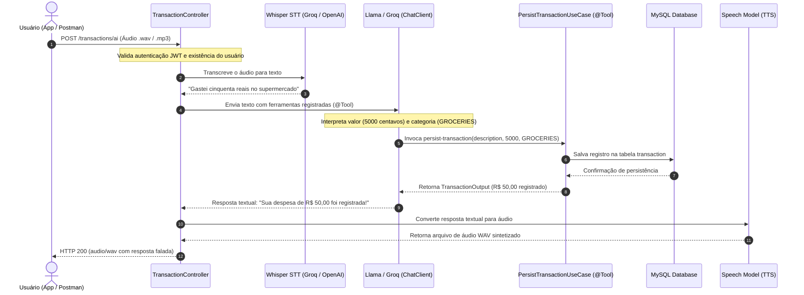
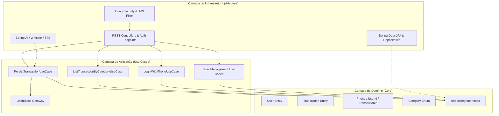

# 🎙️ Voice Budgeting Assistant API (Java + Spring AI)

<p align="center">
  
  
  
  
  
  
  
</p>

> **Projeto Final de Conclusão de Curso — DIO (Digital Innovation One)**  
> API inteligente de reconhecimento de fala e gestão financeira pessoal construída com **Java 23**, **Spring Boot 3**, **Spring AI** e **Clean Architecture**.

---

## 📌 Sobre o Projeto

O **Voice Budgeting Assistant API** é uma solução de backend moderna projetada para permitir que usuários controlem suas finanças pessoais de forma natural: **falando diretamente com a aplicação** ou através de requisições REST tradicionais.

A aplicação integra modelos avançados de Inteligência Artificial Generativa e Processamento de Áudio através do **Spring AI**, realizando o ciclo completo:
1. **Speech-to-Text (STT):** Transcrição de comandos de voz via Whisper (`whisper-large-v3`).
2. **NLU & Tool Calling:** O modelo de linguagem (LLM via Groq/OpenAI) interpreta a intenção do usuário e aciona ferramentas de negócio autônomas (*Function/Tool Calling*) para persistir ou consultar despesas.
3. **Text-to-Speech (TTS):** Síntese da resposta em áudio falado WAV (`orpheus-v1-english` / TTS).
4. **Segurança:** Autenticação *stateless* com **JWT** baseada no número de telefone do usuário.

---

## 🔄 Fluxo de Processamento de Voz (Tool Calling)

O diagrama abaixo ilustra o ciclo de vida de uma requisição de áudio no endpoint multimodal `/users/{userId}/transactions/ai`:



---

## 🏛️ Arquitetura do Sistema

O projeto adota os princípios de **Clean Architecture (Arquitetura Limpa)** e **Domain-Driven Design (DDD)**, organizado em **Contextos Delimitados (Bounded Contexts)** desacoplados:



### Estrutura dos Módulos:
* **`com.application.users`**:
  * `domain`: Entidade `User`, Value Objects (`Phone`, `UserId`) e validação customizada (`@ValidPhone`).
  * `application`: Casos de uso (`LoginWithPhoneUseCase`, `PersistUserUseCase`, etc.) e portas (`TokenGateway`).
  * `infrastructure`: Segurança com Spring Security, filtro JWT (`SecurityFilter`), persistência JPA e `UserController`/`AuthController`.
* **`com.application.budgeting`**:
  * `domain`: Entidade `Transaction`, `Category` (`GROCERIES`, `FARMA`, `AUTO`), `TransactionRepository`.
  * `application`: Casos de uso de transações financeiras e anotações `@Tool` do Spring AI para invocação autônoma pela IA.
  * `infrastructure`: `TransactionController`, controllers de áudio e persistência em banco de dados.
* **`com.application.shared`**:
  * Exceções comuns e `GlobalExceptionHandler` formatando respostas no padrão **RFC 7807 (ProblemDetail)**.

---

## 🗺️ Mapa de Endpoints da API

| Método | Endpoint | Descrição | Autenticação |
| :--- | :--- | :--- | :---: |
| `POST` | `/auth/login` | Autentica usuário por telefone e gera Token JWT | **Pública** |
| `POST` | `/users` | Cadastra novo usuário | **Pública** |
| `GET` | `/users` | Lista todos os usuários cadastrados | `Bearer JWT` |
| `GET` | `/users?id={id}` | Busca usuário por ID | `Bearer JWT` |
| `GET` | `/users?phone={phone}`| Busca usuário por telefone | `Bearer JWT` |
| `PUT` | `/users` | Atualiza dados do usuário | `Bearer JWT` |
| `DELETE`| `/users?id={id}` | Remove usuário | `Bearer JWT` |
| `POST` | `/users/{id}/transactions` | Registra transação manual (valor em centavos) | `Bearer JWT` |
| `GET` | `/users/{id}/transactions/{cat}` | Lista transações por categoria (`GROCERIES`, `FARMA`, `AUTO`) | `Bearer JWT` |
| `POST` | `/users/{id}/transactions/ai` | **Processa áudio, invoca Tool da IA e responde em voz** | `Bearer JWT` |
| `POST` | `/api/synthesize` | Sintetiza texto em áudio falado (`audio/wav`) | `Bearer JWT` |
| `POST` | `/api/transcription` | Transcreve arquivo de áudio direto para texto | `Bearer JWT` |
| `GET` | `/api/chat-client` | Chat com Fluent API do Spring AI | `Bearer JWT` |
| `GET` | `/swagger-ui.html` | Interface visual interativa do Swagger | **Pública** |

---

## 🗣️ Exemplos de Prompts Falados Compreendidos pela IA

O assistente foi afinado com instruções de sistema (`prompts/system-message.st`) para identificar transações e categorias automaticamente:

| Frase Falada no Áudio | Ação Executada pela IA | Categoria | Valor Gravado |
| :--- | :--- | :---: | :---: |
| *"Paguei cinquenta reais no supermercado hoje."* | Invocação da Tool `persist-transaction` | `GROCERIES` | R$ 50,00 (5000 centavos) |
| *"Comprei remédio na farmácia por oitenta e nove reais."* | Invocação da Tool `persist-transaction` | `FARMA` | R$ 89,00 (8900 centavos) |
| *"Abasteci o carro com cem reais de gasolina."* | Invocação da Tool `persist-transaction` | `AUTO` | R$ 100,00 (10000 centavos) |
| *"Quais foram meus gastos na categoria farmácia?"* | Invocação da Tool `list-transaction-by-category` | `FARMA` | *Consulta transações* |

---

## ⚠️ Tratamento de Erros Padronizado (RFC 7807)

A API utiliza o padrão internacional **ProblemDetail (RFC 7807)** gerenciado pelo `GlobalExceptionHandler`:

* **`400 Bad Request`**: Disparado em falhas de validação nos campos `@Valid` ou formatos inválidos de telefone/UUID.
  ```json
  {
    "type": "about:blank",
    "title": "Dados inválidos",
    "status": 400,
    "detail": "Erro de validação nos campos enviados",
    "errors": {
      "phone": "Telefone inválido: precisa seguir o padrão nacional (ex: 5511999998888)"
    }
  }
  ```
* **`404 Not Found`**: Disparado ao buscar usuário ou recurso inexistente.
* **`409 Conflict`**: Violações de chave única no banco de dados (exemplo: telefone já cadastrado).

---

## 🛠️ Tecnologias Utilizadas

* **Linguagem:** Java 23
* **Framework:** Spring Boot 3.5.7
* **Inteligência Artificial:** Spring AI 1.1.0 (OpenAI Starter, Whisper STT, TTS, Groq API)
* **Segurança:** Spring Security 6 + Auth0 Java-JWT (4.5.0)
* **Banco de Dados:** MySQL 8/9 com Docker Compose
* **ORM:** Spring Data JPA / Hibernate
* **Validação:** Jakarta Bean Validation (Hibernate Validator)
* **Produtividade:** Lombok (1.18.38)
* **Documentação:** SpringDoc OpenAPI 2 / Swagger UI 2.8.5

---

## 🧩 Extensões Recomendadas para o VS Code

Para desenvolver, debugar e testar este projeto no **Visual Studio Code** com máxima produtividade, recomendamos as seguintes extensões:

| Extensão | Identificador | Finalidade no Projeto |
| :--- | :--- | :--- |
| **Extension Pack for Java** | `vscjava.vscode-java-pack` | Suporte completo para Java: autocompletion, depuração, JUnit e gerenciamento Maven. |
| **Spring Boot Extension Pack** | `vmware.vscode-spring-boot` | Suporte e navegação de Beans, navegação de rotas e integração com o Spring Boot. |
| **Lombok Annotations Support** | `vscjava.vscode-lombok` | Garante que o VS Code reconheça anotações como `@Getter`, `@Data` e `@AllArgsConstructor` sem erros visuais. |
| **REST Client** | `humao.rest-client` | Permite executar as requisições do arquivo `api.http` diretamente no editor com apenas 1 clique. |
| **Docker** | `ms-azuretools.vscode-docker` | Gerenciamento e visualização rápida do contêiner MySQL do `compose.yml`. |
| **Database Client** | `cweijan.vscode-database-client2` | Permite visualizar as tabelas do MySQL dentro do próprio VS Code. |

> 💡 *As recomendações já estão configuradas no arquivo [`.vscode/extensions.json`](file:///.vscode/extensions.json). Ao abrir o projeto, o VS Code sugerirá a instalação automaticamente.*

---

## 🚀 Como Executar o Projeto

### Pré-requisitos
* **JDK 23** instalado e configurado no `PATH`.
* **Docker** e **Docker Compose** instalados.
* Chave de API da **Groq** (gratuita) ou **OpenAI**.

---

### Passo 1: Clonar o Repositório
```bash
git clone https://github.com/SEU_USUARIO/Java-SpeechRecognizing-API.git
cd Java-SpeechRecognizing-API
```

---

### Passo 2: Subir o Banco de Dados MySQL (Docker)
Na pasta raiz do projeto:
```bash
docker compose -f APISpeechDIO/compose.yml up -d
```
> O banco MySQL iniciará na porta `3307` com a base `transaction`.

---

### Passo 3: Configurar as Chaves de Ambiente
Crie um arquivo `.env` na raiz do projeto (ou configure as variáveis no seu ambiente):
```properties
GROQ_API_KEY=gsk_sua_chave_groq_aqui
```

Ou defina diretamente via terminal:
```bash
# Windows (PowerShell)
$env:GROQ_API_KEY="gsk_sua_chave_groq_aqui"

# Linux / MacOS
export GROQ_API_KEY="gsk_sua_chave_groq_aqui"
```

---

### Passo 4: Compilar e Executar a API

#### Via Terminal com Maven:
```bash
cd APISpeechDIO
mvn clean spring-boot:run
```

#### Via VS Code:
Abra o arquivo `Application.java` e clique em **Run** ou pressione `F5` utilizando o perfil configurado em `.vscode/launch.json`.

---

## 📖 Documentação e Testes da API

### 1. Swagger UI (Interface Interativa)
Com a aplicação rodando, acesse a documentação interativa pelo navegador:  
👉 **[http://localhost:8080/swagger-ui.html](http://localhost:8080/swagger-ui.html)**

### 2. Testes via Arquivo HTTP (`api.http`)
O arquivo [`APISpeechDIO/requests/api.http`](file:///APISpeechDIO/requests/api.http) contém **todas as requisições da API prontas para execução**.

Com a extensão **REST Client** instalada no VS Code:
1. Abra [`APISpeechDIO/requests/api.http`](file:///APISpeechDIO/requests/api.http).
2. Clique em **Send Request** no endpoint `1.1 Criar Usuário`.
3. Clique em **Send Request** no endpoint `1.2 Login com Telefone` (o token JWT e variáveis serão salvos automaticamente!).
4. Execute qualquer rota protegida de transações ou IA.

---

## 🔮 Roadmap & Evoluções Futuras

- [ ] Integração com bot de WhatsApp via Webhook (Twilio / Evolution API).
- [ ] Versionamento de banco de dados com **Flyway**.
- [ ] Testes de integração automatizados ponta a ponta com **Testcontainers**.
- [ ] Suporte a categorias personalizáveis cadastradas dinamicamente pelo próprio usuário.

---

## 📄 Licença

Este projeto é distribuído sob a licença **MIT**. Veja o arquivo `LICENSE` para mais detalhes.

---

## 👨‍💻 Autor

Desenvolvido por **Luiz** como projeto de conclusão de curso do bootcamp da **DIO (Digital Innovation One)**.
